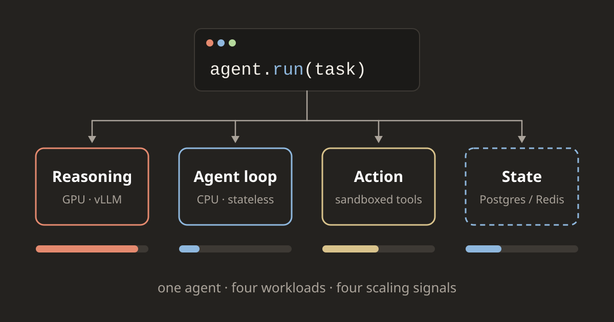
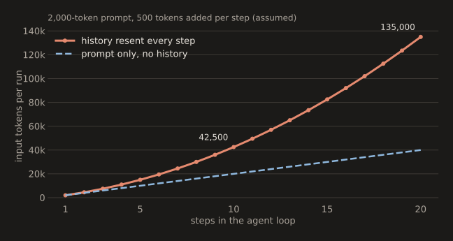

{fig-alt="agent.run(task) fans out into four workloads: reasoning on GPU, the agent loop on CPU, sandboxed tool actions, and state in Postgres or Redis."}

## Introduction

When someone says they have "deployed an agent", I want to know where it runs. There is no single answer, because an agent is really four separate workloads.

This post follows the framing from the IBM Technology video [AI Agent Architecture: Where Does Your Agent Actually Run?](https://www.youtube.com/watch?v=_iTbNy5aOR0), where Legare Kerrison (Red Hat) breaks an agent into a **reasoning plane**, the **agent loop**, an **action plane** and **state**. I find the split useful as a data engineer, because it is close to how we already split compute, orchestration, side effects and storage in a data platform.

## The four workloads

Each part needs different hardware and fails in a different way, so on a cluster you deploy and scale them separately.

```{mermaid}
flowchart LR
    subgraph R["Reasoning plane"]
        M["LLM inference<br/>(vLLM / llm-d on GPU)"]
    end
    subgraph L["Agent loop"]
        A["while loop<br/>(CPU, stateless)"]
    end
    subgraph X["Action plane"]
        T["Tool calls<br/>(sandboxed pods / jobs)"]
    end
    subgraph S["State"]
        D[("Postgres / Redis<br/>checkpoints")]
    end
    A -- "prompt" --> M
    M -- "tokens" --> A
    A -- "dispatch tool" --> T
    T -- "result" --> A
    A -- "checkpoint / resume" --> D
    classDef warm stroke-width:1.5px
    classDef sand stroke-width:1.5px
    classDef later stroke-width:1.5px
    class M warm
    class T sand
```

| Workload | What it does | Bound by | Main risk |
|------------------|------------------|------------------|------------------|
| Reasoning plane | Forward passes that produce tokens | GPU memory and compute | Cost, KV cache pressure |
| Agent loop | Builds prompts, parses responses, dispatches tools | Network waits | Wasting expensive nodes |
| Action plane | Touches the outside world | Whatever the tool does | Security |
| State | Remembers conversations, task status, checkpoints | Storage | Losing work on restart |

Let us take a look at each of them.

## Reasoning plane

The reasoning plane is model inference, the forward passes through the transformer that produce output tokens. It is the heavy part. Most of the GPU memory goes to the model weights and the KV cache.

The reasoning plane runs wherever the model weights are loaded. That can be an API provider's data centre, a pod on your own cluster or a local process on your laptop. On a Kubernetes cluster it is typically a **vLLM** or **llm-d** deployment pinned to GPU nodes. Nothing else in the agent needs a GPU.

## The agent loop

The agent code is small. It assembles a prompt, calls the model, parses the response, decides whether a tool was requested, dispatches it and appends the result. Then it loops.

```{mermaid}
flowchart TD
    Start(["Task arrives"]) --> P["Assemble prompt<br/>from message history"]
    P --> C["Call model"]
    C --> Q{"Tool requested?"}
    Q -- "yes" --> D["Dispatch tool"]
    D --> AP["Append result<br/>to messages"]
    AP --> P
    Q -- "no" --> Done(["Return answer"])
    classDef warm stroke-width:1.5px
    classDef sand stroke-width:1.5px
    classDef later stroke-width:1.5px
    class C warm
    class D sand
```

The shape of this code is the same regardless of framework. As an example, stripped to the skeleton:

``` python
def run_agent(task, call_model, tools):
    messages = [{"role": "user", "content": task}]

    while True:
        response = call_model(messages)
        messages.append(response.message)

        if not response.tool_calls:
            return response.message  # done

        for call in response.tool_calls:
            result = tools[call.name](**call.arguments)
            messages.append({"role": "tool", "name": call.name, "content": result})
```

Frameworks add state management, persistence, human approval steps and handoffs between several loops, but underneath it is the same loop.

For deployment, what matters is that this code is light. Almost all its time goes to waiting for the model or a tool. On a cluster it belongs in a stateless deployment on cheap CPU nodes, scaled horizontally with a Horizontal Pod Autoscaler.

``` yaml
apiVersion: apps/v1
kind: Deployment
metadata:
  name: agent-loop
spec:
  replicas: 2
  selector:
    matchLabels: {app: agent-loop}
  template:
    metadata:
      labels: {app: agent-loop}
    spec:
      nodeSelector:
        node-pool: cpu-general   # never the GPU pool
      containers:
        - name: agent
          image: registry.example.com/agent-loop:1.0
          resources:
            requests: {cpu: "250m", memory: "256Mi"}
```

Don't schedule it on the GPU nodes. Then you pay GPU prices for a loop that is mostly waiting.

## Action plane

The action plane is where the agent takes actions through tool calls. This is the code that touches the world: HTTP calls, database queries, shell commands, file writes and browser automation.

It is also the part where security matters most, because this is where the model's output gets side effects. The main question here is what this code can reach and with which credentials. The video suggests sandboxing it with:

-   Ephemeral, short-lived pods or jobs, or hardened containers.
-   A default-deny network policy with an explicit egress allow list.
-   A service account scoped to exactly what the tool needs, separate from the loop's own credentials.

```{mermaid}
flowchart LR
    A["Agent loop<br/>(own service account)"] -- "dispatch" --> J
    subgraph SB["Sandbox: ephemeral pod / job"]
        J["Tool runtime<br/>(tool-scoped service account)"]
    end
    J -- "allowed egress" --> API["Approved API"]
    J -. "denied" .-x DB[("Production DB")]
    J -. "denied" .-x NET["Rest of the internet"]
    classDef warm stroke-width:1.5px
    classDef sand stroke-width:1.5px
    classDef later stroke-width:1.5px
    class J sand
    class DB,NET later
```

The default-deny part is a few lines of Kubernetes:

``` yaml
apiVersion: networking.k8s.io/v1
kind: NetworkPolicy
metadata:
  name: tool-sandbox-egress
spec:
  podSelector:
    matchLabels: {role: tool-sandbox}
  policyTypes: [Egress]
  egress:
    - to:
        - ipBlock: {cidr: 10.20.30.0/24}   # the one service this tool may call
      ports:
        - {protocol: TCP, port: 443}
```

Because the policy selects the pods and lists only one egress rule, everything else is denied.

## State

The agent has to remember the conversation, the task status and where it got to. Locally this is just a Python list in memory. In the loop above, `messages` is the whole state.

In production the important choice is whether this state stays in the process or moves out of it. On Kubernetes it is the difference between an agent that is a StatefulSet with a persistent volume, and an agent that is a stateless deployment checkpointing to Postgres or Redis.

```{mermaid}
flowchart LR
    IN(["State in process"]) --> P1["Pod holds messages<br/>in memory"] --> R1["Pod restarts"] --> X1["Task starts<br/>from zero"]
    EXT(["State externalized"]) --> P2["Pod checkpoints to<br/>Postgres / Redis"] --> R2["Pod crashes, is rescheduled<br/>or scaled to zero"] --> X2["New pod resumes<br/>from last checkpoint"]
    classDef warm stroke-width:1.5px
    classDef sand stroke-width:1.5px
    classDef later stroke-width:1.5px
    class IN,P1,R1,X1 warm
```

With the state outside, pods can crash, get rescheduled mid-task or scale to zero overnight and still resume from the last checkpoint. If the state stays in the process, a restart means the task starts from zero. If you have built streaming jobs you know this. It is the same reason we checkpoint a Structured Streaming query to durable storage and don't trust the driver.

A small change to the loop is enough, where `store` wraps a Postgres table or a Redis key:

``` python
def run_agent(task_id, call_model, tools, store):
    messages = store.load(task_id)  # resume if a checkpoint exists

    while True:
        response = call_model(messages)
        messages.append(response.message)
        store.save(task_id, messages)

        if not response.tool_calls:
            return response.message

        for call in response.tool_calls:
            store.save(task_id, messages, pending_tool=call)  # checkpoint before acting
            result = tools[call.name](**call.arguments)
            messages.append({"role": "tool", "name": call.name, "content": result})
            store.save(task_id, messages)
```

## Deployment tips

The video ends with a few practical rules. The first is to scale each plane on its own signal: inference on KV cache pressure, the loop on request concurrency, the tools on job queue depth and state on storage. A single autoscaler for all four will not fit.

The second is to checkpoint before every tool call, not only after. A tool call is where something irreversible can happen. If the pod dies in the middle of one, a checkpoint written beforehand tells the next pod that the call was in flight, so it can check the outcome or rely on the tool being idempotent instead of running it twice. That is what the `pending_tool` checkpoint in the code above is for.

The third is to give the loop, the tools and the inference endpoint each their own identity, so a bad tool call can only reach what that one tool needs.

## Four questions to ask

When someone tells me they have deployed an agent, these are the four questions I would ask:

1.  Reasoning: where are the model weights loaded, and what hardware does inference run on?
2.  Loop: where does the agent loop run, and is it on cheap, horizontally scaled CPU nodes?
3.  Action: what can the tool code reach, and with whose credentials?
4.  State: where does the state live, and what happens when a pod restarts mid-task?

A good answer keeps the four apart. If the answer is "a container on the GPU box", it is worth asking the questions again.

## Perspectives

One question the video does not answer is how much more compute it takes when an agent runs a workflow instead of a normal pipeline. I do not have data on this. What follows is a thought experiment, not a measurement.

### A rough model

A normal pipeline makes zero or one model call. The agent loop shown earlier makes one call per step, and every call sends the full message history again. If each step adds roughly the same number of tokens, the total input over a run grows with the square of the number of steps, not linearly.

Writing $p$ for the starting prompt, $k$ for the tokens each step adds (tool result plus model reply) and $n$ for the number of steps:

$$
\text{input tokens} \approx n \cdot p + k \cdot \frac{n(n-1)}{2}
$$

As an example we can put some made-up numbers into it:

```python
def agent_input_tokens(steps, prompt_tokens=2_000, tokens_per_step=500):
    """Input tokens sent to the model over a whole run, if every step
    resends the full history and nothing is cached or trimmed."""
    return sum(prompt_tokens + tokens_per_step * i for i in range(steps))

for steps in [1, 5, 10, 20, 40]:
    total = agent_input_tokens(steps)
    print(f"{steps:>3} steps: {total:>9,} tokens  ({total / 2_000:>5.1f}x a single call)")
```

```
  1 steps:     2,000 tokens  (  1.0x a single call)
  5 steps:    15,000 tokens  (  7.5x a single call)
 10 steps:    42,500 tokens  ( 21.2x a single call)
 20 steps:   135,000 tokens  ( 67.5x a single call)
 40 steps:   470,000 tokens  (235.0x a single call)
```

{fig-alt="Line chart of input tokens per run against the number of agent steps. With the history resent every step the line curves upward to 135,000 tokens at 20 steps; with the prompt only it grows linearly to 40,000."}

With these assumptions a ten-step run sends about 21 times the tokens of a single call, and doubling to twenty steps roughly triples the total again.

### Where the extra compute would land

If the model is roughly right, the extra cost is not spread evenly over the four planes.

| Plane | What I expect per run | Grows with |
|---|---|---|
| Reasoning | Most of the extra cost, as GPU time or API tokens | steps and context size |
| Agent loop | Very little; it mostly waits | steps |
| Action | Depends on the tools; could be large if a tool runs a query or a Spark job | tool calls and retries |
| State | Small; a few checkpoints | steps |

The action row is the one I would watch as a data engineer. An agent that decides to "check the table again" may run a full query every time, and that cost does not show up in the token count at all.

### What this model ignores

The model leaves out a lot, and it could move the numbers in both directions. Prompt caching is the big one. Many API providers price cached input lower, and self-hosted servers like vLLM can reuse the KV cache for a repeated prefix, so resending the history may cost much less than the count suggests. Frameworks that trim or summarise old steps also break the quadratic growth.

Other things push the other way. I only count input tokens, and output tokens are usually more expensive. Agents don't take a fixed number of steps, so a run that loops or retries can be far longer than planned. And tokens are only a proxy: on a self-hosted model the compute per token also rises with context length.

### What I would want to measure

To turn this into something I could stand behind, I would log for each run the number of steps, input and output tokens per call, how much was served from cache, and the compute used by each tool call. Comparing that with the same workflow written as a plain pipeline would show the real overhead. Until then, my working assumption is that the extra compute of an agent sits mostly in the reasoning plane and in the tools it calls, and that it grows faster than the number of steps.

## Conclusion

Splitting an agent into reasoning, loop, action and state gives four concrete deployment decisions instead of one vague "where does it run". For a data engineer the split is familiar, and that is the main reason I like it.

What it does not tell me is what an agent costs each time it runs a workflow. I have not measured that yet. This can be explored further.
